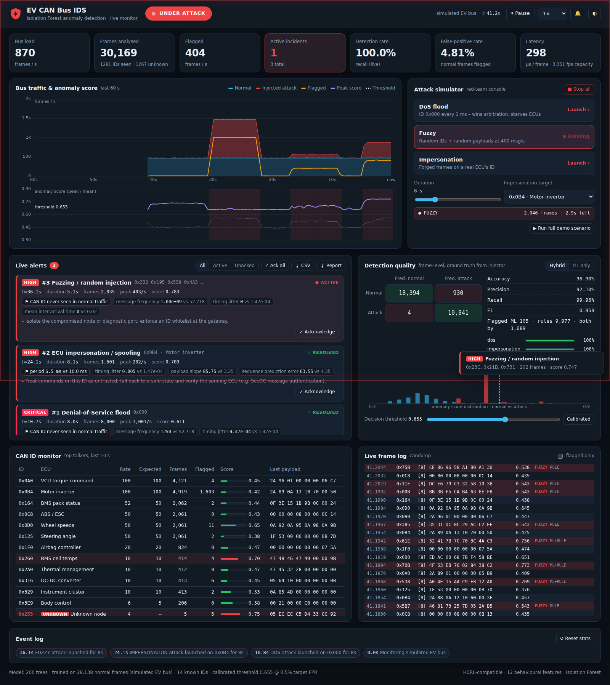
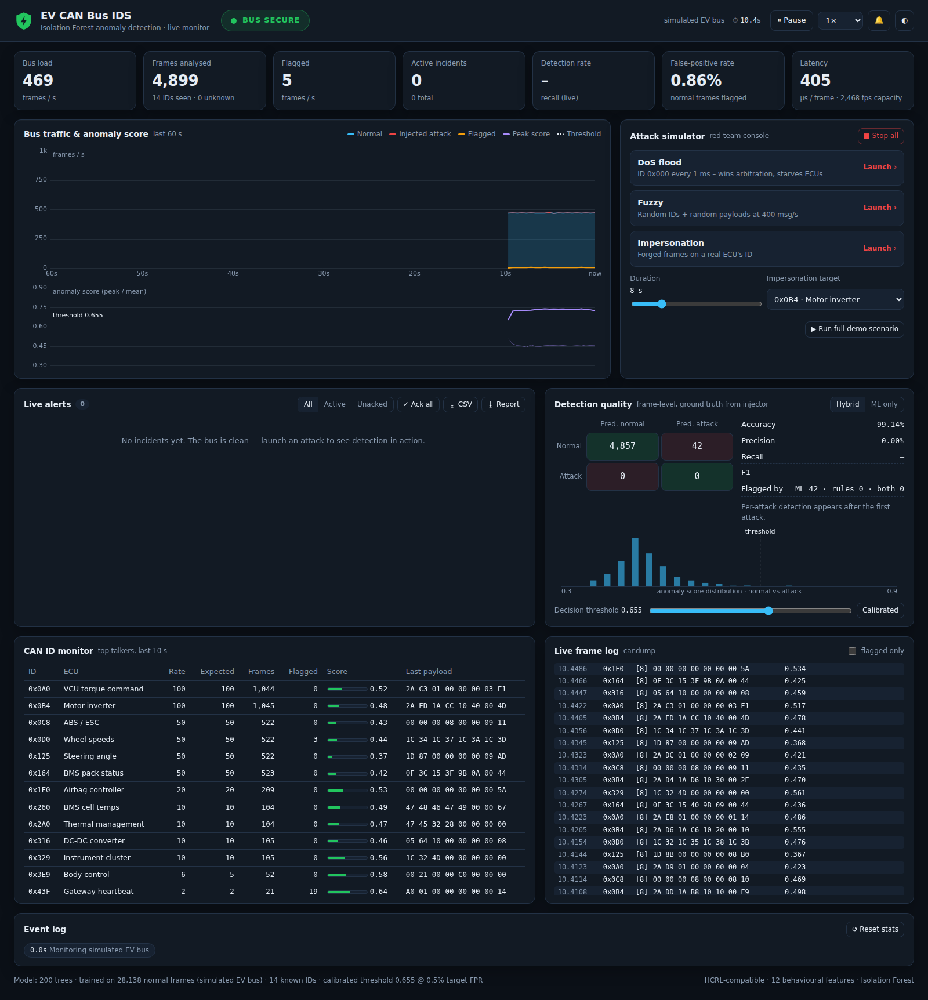
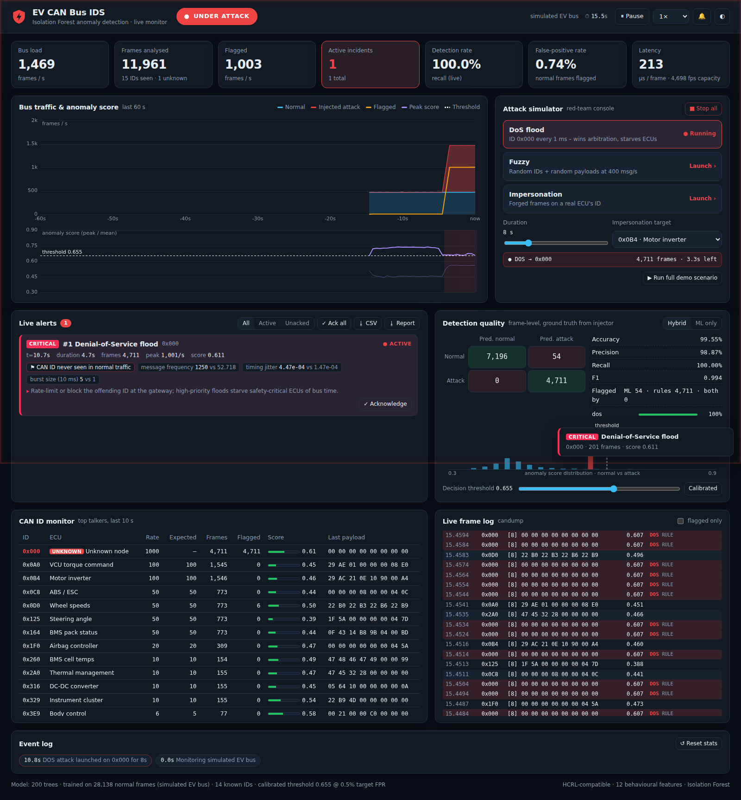
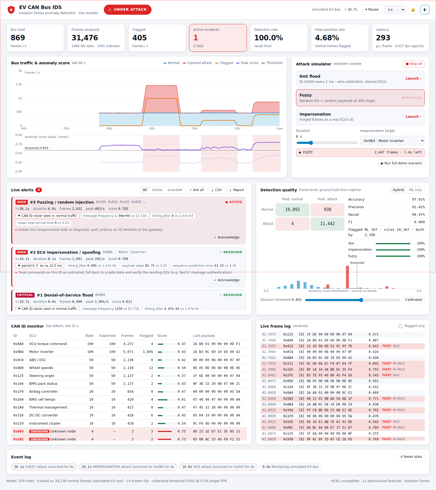
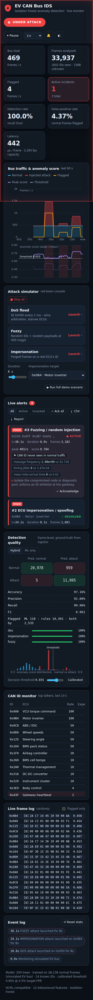

# EV CAN Bus Intrusion Detection System (IDS)
A Lightweight Machine Learning–Based IDS for Electric Vehicle CAN Networks, with a **real-time alerting dashboard**



🎬 **Explainer video (3½ min, narrated):** [`docs/video/ev_can_ids_explainer.mp4`](docs/video/ev_can_ids_explainer.mp4). It covers the CAN bus problem, the three attacks, how detection works, a live dashboard demo and the results.

---

## Overview

This project implements an anomaly-based Intrusion Detection System (IDS) for Electric Vehicle (EV) Controller Area Network (CAN) communication using machine learning.
The CAN bus lacks authentication, message integrity and encryption, making it vulnerable to cyberattacks.
This IDS uses an unsupervised Isolation Forest model to detect abnormal CAN behaviour based on timing and payload patterns.

The research notebook processes more than 4.7 million CAN messages from the HCRL CAN Intrusion Dataset, with engineered behavioural features to detect:
- DoS attacks
- Fuzzy attacks
- Impersonation attacks

On top of the notebook, the repository contains a **deployable streaming IDS** (`can_ids/`):

| Component | What it does |
|---|---|
| **Streaming feature engine** | Computes the notebook's 12 behavioural features one frame at a time, with O(1) state per CAN ID, so the IDS can run on a live bus |
| **Hybrid detector** | Isolation Forest anomaly score plus specification rules learned from the same normal traffic (ID whitelist, per-ID timing, per-ID payload bounds) |
| **Attack classifier & explainer** | Labels each detection as DoS, Fuzzy, Impersonation or Anomaly, and explains *why* (e.g. "period 5.0 ms vs 10.0 ms") |
| **Alert manager** | Turns thousands of flagged frames into a handful of incidents, with severity, escalation, auto-resolve, acknowledgement and recommended response |
| **Alert sinks** | Live dashboard, console, JSON-lines log (SIEM friendly), and Slack/Discord/Teams/generic webhooks |
| **Live dashboard** | Web SOC console with live charts, alert feed, CAN ID monitor, candump log, live confusion matrix and a red-team attack simulator |
| **EV bus simulator** | 14 EV ECUs (BMS, inverter, VCU, ABS, charger…) driven by a vehicle model, plus on-demand DoS / Fuzzy / Impersonation injection, so the demo runs without the multi-GB dataset |
| **HCRL replay** | Streams the original HCRL `.txt` logs through the same pipeline |

---

## Quick start

```bash
pip install -r requirements.txt
python -m can_ids dashboard --open        # http://localhost:8050
```

On first run the model trains on 60 s of simulated normal traffic (about 4 s) and is saved to `models/ids_model.joblib`.
In the dashboard, press **Launch** on any attack, or **Run full demo scenario** for DoS → Fuzzy → Impersonation, 20 s apart.

Other commands:

```bash
python -m can_ids monitor --demo                 # headless: alerts printed to the terminal
python -m can_ids evaluate                       # Isolation Forest vs hybrid metrics table
python -m can_ids train --retrain                # retrain and recalibrate
python -m can_ids dashboard --webhook https://hooks.slack.com/services/...   # push HIGH+ alerts to Slack

# Use the real HCRL data instead of the simulator
python -m can_ids dashboard --train-file data/Attack_free_dataset.txt --retrain \
                            --replay data/DoS_attack_dataset.txt
python -m can_ids evaluate  --train-file data/Attack_free_dataset.txt --retrain --limit 200000 \
                            --normal data/Attack_free_dataset.txt \
                            --attack dos=data/DoS_attack_dataset.txt \
                            --attack fuzzy=data/Fuzzy_attack_dataset.txt \
                            --attack impersonation=data/Impersonation_attack_dataset.txt
```

Docker: `docker build -t ev-can-ids . && docker run -p 8050:8050 ev-can-ids`

Tests: `pip install -r requirements-dev.txt && pytest` (they also run in GitHub Actions).

---

## Live dashboard

| Normal operation | DoS flood detected |
|---|---|
|  |  |

| Light theme (for projectors) | Mobile |
|---|---|
|  |  |

- **Status banner**: `BUS SECURE` → `WARNING` → `UNDER ATTACK`, with a pulsing red frame, browser-tab icon and audible alarm (toggle 🔔).
- **KPIs**: bus load, frames analysed, flagged frames/s, active incidents, live recall, live false-positive rate and per-frame latency (≈250 µs, i.e. >3,500 frames/s capacity in pure Python).
- **Traffic & score timeline**: normal and injected traffic, flagged frames, peak and mean anomaly score against the threshold, with attack windows shaded.
- **Live alerts**: one card per incident, with severity, affected ECU or IDs, duration, frame count, peak rate, the rules and features that triggered it, and a recommended response. Incidents can be filtered, acknowledged and exported (CSV or a full JSON report).
- **Detection quality**: a live confusion matrix, precision, recall and F1, per-attack detection rate, and the score distribution for normal vs attack traffic. A **threshold slider** shows the precision/recall trade-off live, and a **Hybrid / ML only** switch shows what the rules add.
- **CAN ID monitor**: rate vs learned rate per ID, with unknown IDs highlighted. **Live frame log** is a candump view that marks flagged frames with the attack type and which detector caught them.

### How alerts are generated

```
CAN frame ─► 12 streaming features ─► Isolation Forest score ─┐
                 │                                            ├─► flagged? ─► classify (DoS/Fuzzy/Impersonation)
                 └──────► specification rules ────────────────┘                    │
                          (unknown ID, rate, payload bounds)                       ▼
                                                               AlertManager: group by (type, ID) in a 1 s window
                                                               open incident at N hits · escalate · resolve after 3 s quiet
                                                                                   │
                                                          dashboard · console · alerts.jsonl · webhook
```

Single flagged frames never page anyone. An incident opens only when a group sees several flagged frames within a second (5 for DoS and Fuzzy, 8 for Impersonation, 12 for generic anomalies). This suppresses isolated false positives: a 0.5 % per-frame false-positive rate produces no incidents on clean traffic.

### Why a hybrid detector?

Running the notebook's Isolation Forest on a live stream exposed two structural limits:

1. **It cannot learn from features that are constant in normal traffic.** "Is this a known CAN ID?" is always *yes* during training, so the forest never splits on it. Fuzzing with never-seen IDs therefore looks like the first frame of an ordinary ID.
2. **It does not score values beyond the training range higher than the most extreme training point.** A 1 ms DoS flood (10× faster than any real ECU) gets a similar score to the fastest normal ECU.

Both gaps are closed by per-ID specification rules learned from the **same normal-only training data**, so the approach stays unsupervised. Simulated evaluation (`python -m can_ids evaluate`, 39,672 frames):

| Metric | Isolation Forest only | Hybrid (IF + rules) |
|---|---|---|
| Accuracy | 73.18 % | **97.48 %** |
| Recall | 15.62 % | **99.98 %** |
| Precision | 78.58 % | **92.34 %** |
| False-positive rate | 1.85 % | 3.60 % |
| F1 | 26.06 % | **96.01 %** |
| DoS / Fuzzy / Impersonation recall | 0 % / 50 % / 33 % | **100 % / 100 % / 99.8 %** |

Most of the hybrid "false positives" are **genuine frames from the ECU being impersonated**. Its timing really is disrupted while the attacker transmits on its ID, but frame-level labelling (as in the notebook) counts those frames as normal. The rest come from fuzzing: when a random ID collides with a known ECU, that ECU's payload history is corrupted for a few frames. On clean traffic the false-positive rate stays near the 0.5 % calibration target.

### Scoring change vs. the notebook

The notebook min-max normalises scores over the whole test set, which is impossible on a live stream. The streaming IDS uses the standard Isolation Forest anomaly score `s(x) = 2^(−E[h(x)]/c(n))` (`-score_samples`, in (0, 1)). It calibrates the threshold as the 99.5th percentile of **training** scores, so the operator picks a target false-positive rate rather than a raw number.

---

## Research notebook results (HCRL dataset)

Notebook: [`EV_CAN_IDS_Project.ipynb`](EV_CAN_IDS_Project.ipynb) — Isolation Forest, min-max normalised score, threshold 0.1.

| Metric | Score |
|--------|--------|
| Accuracy | 84.80% |
| Recall (Attack Detection Rate) | 89.32% |
| Precision | 93.63% |
| False Positive Rate | 59.51% |
| TP / FP / TN / FN | 1,983,963 / 134,997 / 91,854 / 237,203 |

### Key features

- Unsupervised anomaly detection using Isolation Forest
- Behaviour-based feature engineering, including:
  - Timing intervals
  - Rolling statistics
  - Burstiness and jitter
  - Payload entropy
  - Bit-flip count
  - Payload correlation
  - Sequence prediction error

### Testing and validation

- Dataset conversion verification
- Feature engineering execution logs
- Isolation Forest training confirmation
- Anomaly score and prediction generation
- Evaluation using accuracy, recall, precision and FPR
- Confusion matrix, classification report, anomaly score distribution
- **Streaming package:** 20 automated tests covering parsing, feature parity with the notebook's definitions, the simulator, detection per attack type, alert lifecycle, the engine and the dashboard API

---

## Project structure

```
can_ids/
  frame.py        CAN frame + HCRL log parser
  features.py     streaming version of the notebook's 12 features
  model.py        Isolation Forest, calibration, rules, attack typing, explanations, evaluation
  simulator.py    EV ECU simulator, HCRL replay, attack injector
  alerts.py       incident manager + console / JSONL / webhook sinks
  engine.py       real-time pipeline and dashboard state
  dashboard/      Flask app (SSE live updates), HTML/CSS/JS with no external dependencies
  cli.py          python -m can_ids {dashboard,monitor,train,evaluate}
tests/            pytest suite
docs/             screenshots, presentation run-sheet, explainer video
  video/          scenes.html + make_video.py (regenerates the video with offline TTS)
```

## Technologies Used

- Python 3
- pandas, NumPy, SciPy
- scikit-learn (Isolation Forest)
- Flask with Server-Sent Events (live dashboard)
- Vanilla JS + Canvas (charts; works offline, no CDN)
- Matplotlib, Google Colab (notebook)
- HCRL CAN Intrusion Dataset
